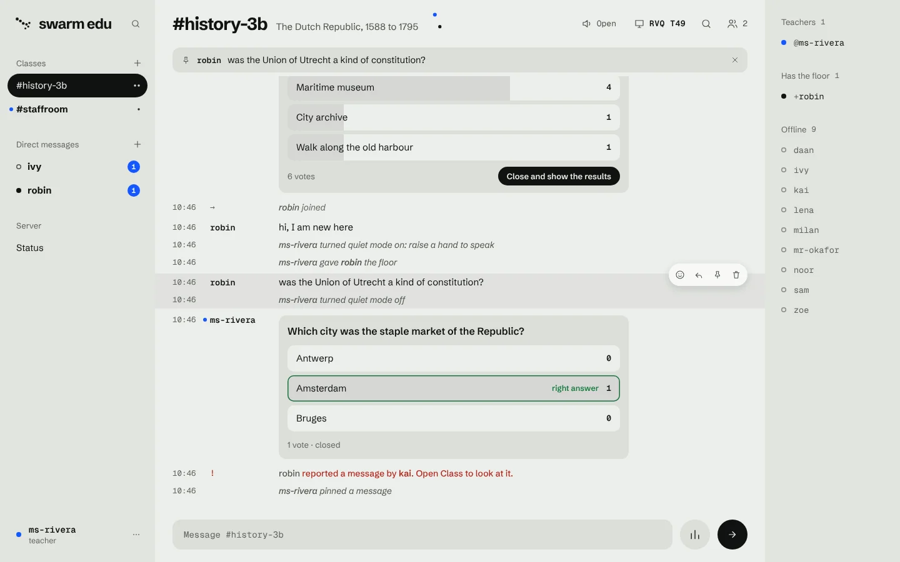
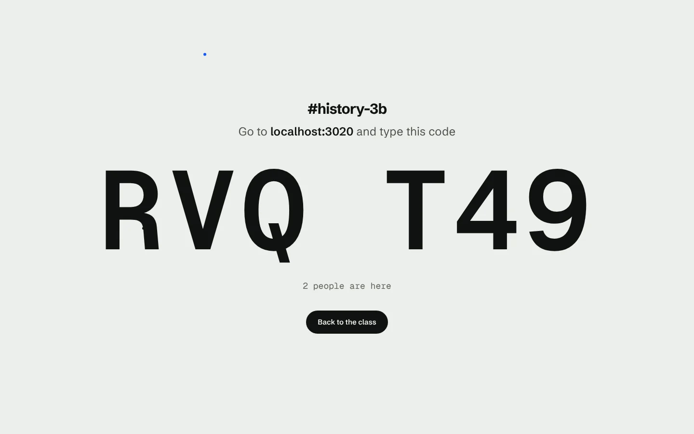
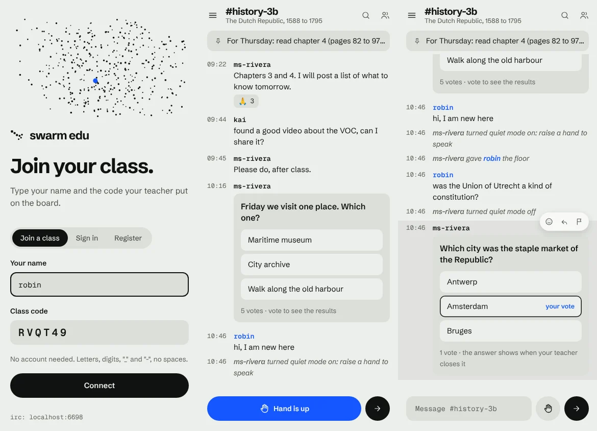
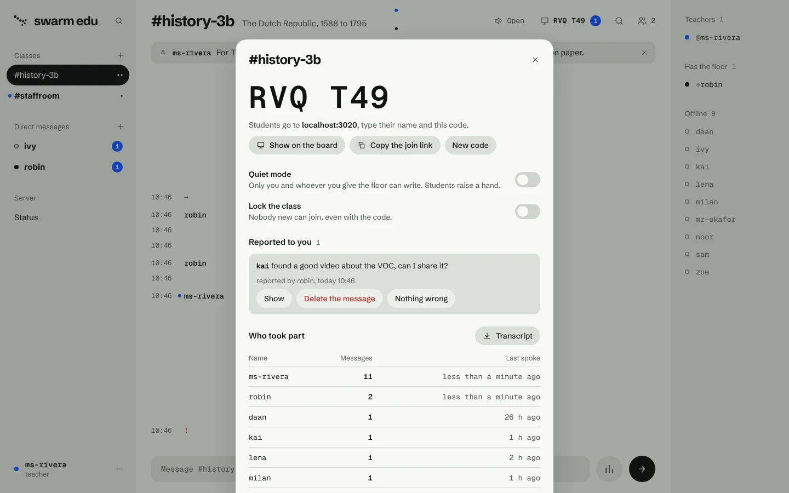
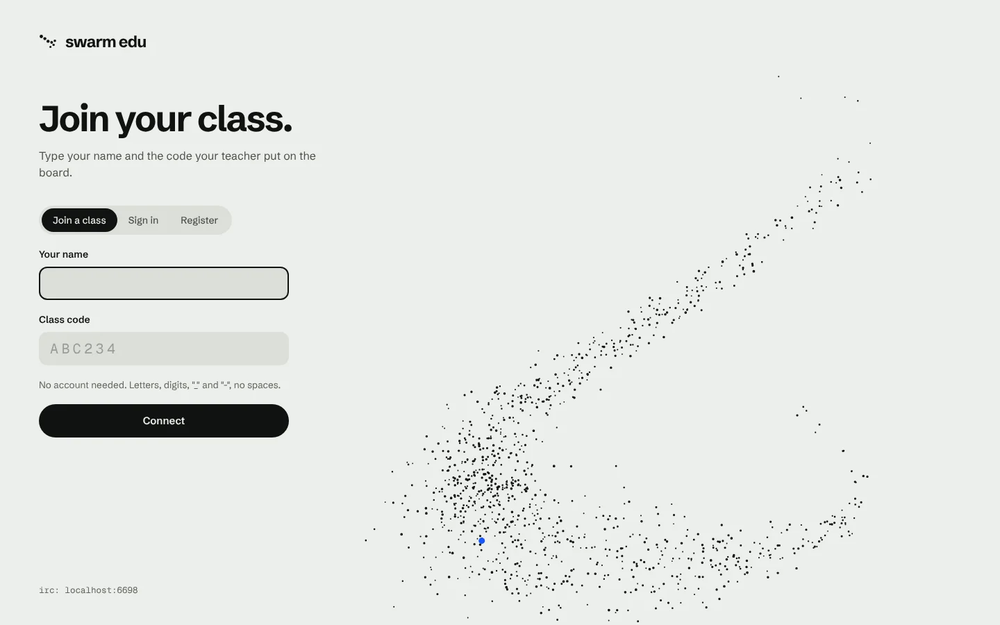

# Swarm Edu

## About this publication

This source code accompanies the AI Report masterclass on building software with AI.
You can study, run, fork and adapt the project under the [MIT license](LICENSE).
It is a masterclass example project; no hosted service or ongoing maintenance is offered.

Swarm, a modern take on IRC, made
for the classroom. A teacher opens a class and puts its code on the board;
students type their name and the code and are in. No accounts to hand out, no
app to install, and any IRC client still works.

The original Swarm repository is not included in this public selection. This
repository contains the source needed for the education version.



| On the board | In a student's hand |
| --- | --- |
|  |  |

## What it adds to Swarm

| In the classroom | How it works here |
| --- | --- |
| **Classes with a code** | A teacher opens `#history-3b`; it gets a six-character code (no `0/O` or `1/I`). Students join with their name and the code, or through a link such as `https://chat.school.example/#join=K7M2QX`. A new code shuts the old one at once. |
| **Teachers and students** | Teachers are accounts, made with the school's staff code or named in the configuration. Only teachers open classes. Students join them, as guests or with an account of their own that keeps their classes and messages. |
| **The board view** | "Show on the board" fills the screen with where to go and what to type, and counts people in as they arrive. |
| **Quiet mode and hands** | One press and only the teacher writes. Students raise a hand; the hands queue up in order; "Give the floor" lets one student write and lowers the hand. |
| **Polls and quizzes** | A poll shows its results to everyone who has voted. A quiz has a right answer: nobody but the teacher sees tally or answer until it is closed. |
| **A pinned message** | The assignment or the rule of the day stays at the top of the class. |
| **Report to the teacher** | Any student can flag a message. Only the people who run the class see the report and who made it. |
| **Who took part** | Per class: who wrote how much and when they last spoke, and the transcript as a text file. |
| **Private messages need a teacher** | A student can write privately to a teacher, never to another student. |
| **Students see their own classes** | The class list of the school is for teachers. |

Everything Swarm already did is still there: history, replies, reactions,
edits, unread markers, search, several devices on one name, the Day and Dusk
themes, and the IRC gateway.

## Run it

Needs Node.js 22.13 or newer. The only dependency is `ws`; the database is the
SQLite that ships with Node.

```bash
npm install
```

```bash
SWARM_TEACHER_CODE='pick-a-staff-code' npm start
```

Then open http://localhost:3000.

1. **A teacher** chooses *Register*, picks a name and a password, and types the
   staff code. (Someone who registered without it can type
   `/teacher <staff code>` later.)
2. The teacher opens a class with the plus beside *Classes*, or `/class
   history-3b`. Its code is in the top bar; *Show on the board* puts it on the
   projector.
3. **Students** open the same address, type their name and the code, and
   connect.

Without `SWARM_TEACHER_CODE` or `SWARM_TEACHERS` nobody can become a teacher,
so nobody can open a class; the server says so when it starts.

To look around a school that already has two teachers, ten students, three
classes and a quiz:

```bash
DB_PATH=data/demo.db npm run seed
```

```bash
DB_PATH=data/demo.db npm start
```

Every demo account (`ms-rivera`, `mr-okafor`, `noor`, `daan`, …) has the
password `swarm-demo`; the seed prints the class codes.

With Docker:

```bash
docker build -t swarm-edu .
```

```bash
docker run -p 3000:3000 -p 6667:6667 -e SWARM_TEACHER_CODE='pick-a-staff-code' -v swarm-edu-data:/app/data swarm-edu
```

## For teachers

| You want to | Do this |
| --- | --- |
| Open a class | Plus beside *Classes*, or `/class <name>` |
| Let students in | Top bar → the code → *Show on the board* or *Copy the join link* |
| Stop latecomers or strangers | *Lock the class* in the class panel, or `/lock` |
| Change the code | *New code* in the class panel, or `/code new` |
| Have the floor to yourself | The *Open / Quiet* button in the top bar, or `/quiet` |
| Let one student write | Click the name under *Hands up* → *Give the floor*, or `/floor <name>` |
| Ask the class something | The bars button beside the message box, or `/poll Question \| A \| B` |
| Ask with a right answer | Mark an option as right, or `/quiz Question \| A \| *B \| C` |
| Keep a message on top | Hover the message → pin; `/unpin` takes it down |
| Deal with a report | Class panel → *Reported to you* |
| See who took part, save the lesson | Class panel → *Who took part* → *Transcript* |
| Remove or ban someone | Click the name → *Remove from the class* / *Ban* |
| Share a class with a colleague | Click their name → *Let them run the class* |

Any teacher can walk into any class without its code (unless it is locked);
they run it only when the class's teacher lets them.



## For students



Type your name and the class code, press *Connect*. In the class:

- the hand button beside the message box raises and lowers your hand (`/hand`);
- in quiet mode you can read, vote and raise your hand, and write once your
  teacher gives you the floor;
- hover a message to react, reply or report it to your teacher;
- `/register <password>` keeps your name, your classes and your messages for
  next time; `/joincode <code>` adds another class.

## The school rules

These are on by default. Switch them all off and this is plain Swarm again.

| Rule | Environment variable to change it |
| --- | --- |
| A guest needs a class code to come in | `SWARM_GUESTS_NEED_CODE=0` |
| Only teachers open classes | `SWARM_ONLY_TEACHERS_CREATE=0` |
| Private messages need a teacher at one end | `SWARM_STUDENT_DMS=1` |
| Students only see their own classes in the list | `SWARM_PRIVATE_LIST=0` |

Things worth knowing:

- **A class lives as long as it has members.** Registered members, the teacher
  included, stay members while offline, so a class normally outlives the
  lesson. When its last member leaves, the class and its history are deleted.
- **Guests** hold their name only while connected (a short disconnect goes
  unnoticed). Their messages stay in the class; their private messages are not
  kept.
- **Codes and sign-ins are rate-limited** per address: ten wrong passwords,
  class codes or staff codes lock that address out for ten minutes.
- **Reports and transcripts stay on your server.** The client loads nothing
  from other hosts.
- **Bans** are on a name; for a registered name they follow the account.

## Configuration

Environment variables, all optional:

| Variable | Default | Meaning |
| --- | --- | --- |
| `SWARM_TEACHER_CODE` | none | The staff code: registering with it, or `/teacher <code>`, makes a teacher |
| `SWARM_TEACHERS` | none | Registered names that are teachers, comma-separated |
| `PORT` | `3000` | Web client and WebSocket |
| `IRC_PORT` | `6667` | IRC gateway; `0` switches it off |
| `HOST` | `0.0.0.0` | Address to listen on |
| `DB_PATH` | `data/swarm.db` | SQLite file; `:memory:` keeps nothing |
| `SWARM_NAME` | `Swarm Edu` | Name of the school's network |
| `SWARM_MOTD` | a welcome line | Shown on connect |
| `SWARM_CHANNELS` | none | Channels everyone lands in, comma-separated; a school usually has none |
| `SWARM_ADMINS` | none | Registered names that run those default channels |
| `SWARM_GRACE_MS` | `20000` | How long a dropped user stays "online" |
| `TRUST_PROXY` | off | `1` to take the client address from `X-Forwarded-For` |

Both ports speak plain text. For anything beyond a trusted network, and
certainly for a school, put a TLS terminator in front of them.

## Connecting with an IRC client

The classroom maps onto IRC as it is:

| Classroom | IRC |
| --- | --- |
| Class code | Channel key, mode `+k` |
| Quiet mode | Moderated, mode `+m` |
| Having the floor | Voice, mode `+v` |
| Locked class | Invite-only, mode `+i` |
| Running the class | Operator, mode `+o` |

- **A student** connects with the class code as the server password:
  `/connect localhost 6667 K7M2QX`. They arrive in that class as a guest.
  `JOIN #class <code>` adds another one.
- **A registered name** connects with its own password as the server password.
  `/msg NickServ REGISTER <password>` registers a guest's name.
- Clients that ask for the `server-time` capability get the last 50 messages
  of every class replayed with their real timestamps.
- A poll arrives as a notice with its question and options; voting, hands,
  pins and reports are in the web client only.
- `MODE #class +k` gives a class a new code (the key a client sends is
  ignored: codes are generated), `-k` removes it.

## For developers

```
src/core/hub.js      the chat itself; the section "school" holds the classroom
src/db.js            everything that survives a restart (SQLite)
src/gateways/ws.js   JSON over WebSocket, for the web client
src/gateways/irc.js  the IRC protocol, for everything else
public/js/ui/school.js   class panel, board view, poll dialog, hand and pin
public/js/ui/poll.js     a poll inside its message
public/css/school.css    the classroom's styles, on top of app.css
test/school.test.js      the school rules, in the hub and over both gateways
```

```bash
npm test
```

```bash
npm run dev
```

### Staying close to Swarm

This repository is a fork: `main` started as Swarm's history, and the
education edition is built on top of it. The original Swarm repository is
private and is not part of this public selection. This repository includes
the source needed to work with the education edition on its own.

The classroom is written to merge cleanly. New behaviour sits behind the
`school` settings of the hub, and the suites inherited from Swarm
(`test/hub.test.js`, `test/gateways.test.js`) run with those settings off, so
they still describe plain Swarm. New client code lives in its own files
(`school.js`, `poll.js`, `school.css`).

What the WebSocket protocol gained: `hello` takes a `code` (class code) and a
`teacherCode`; new operations `joinCode`, `code`, `teacher`, `hand`, `poll`,
`vote`, `closePoll`, `pin`, `report`, `resolveReport`, `participation` and
`transcript`; new events `hand`, `pin`, `code` and `reports`. A message of
kind `poll` carries a `poll` object that differs per reader: `counts` and
`correct` are `null` until that reader is allowed to see them.

The look is Swarm's house style, Murmuration: every person is a dot, and you
are the coloured one. On the board view the class's flock grows as students
join. See `docs/design/` for the original concepts.

## License

MIT
