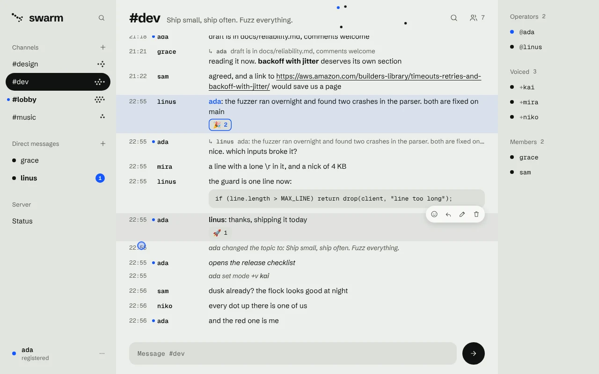
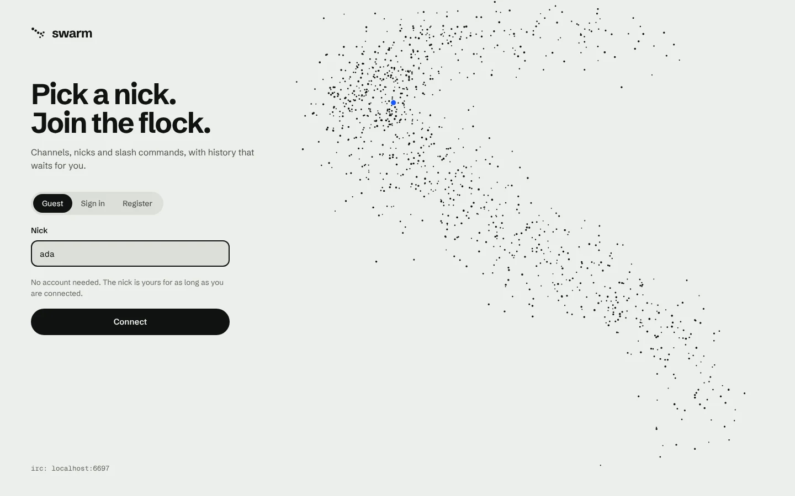
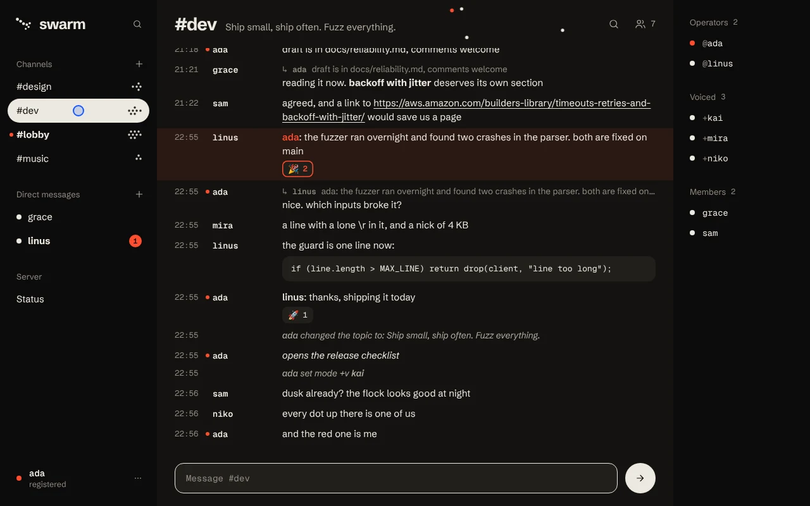

# Swarm

A modern take on IRC. Channels, nicks and slash commands, the way IRC has always
worked, plus the things people now expect from a chat: history that waits for
you, accounts, replies, reactions, edits, unread markers and a web client.

Real IRC clients can connect too. A browser tab and irssi can be signed in to
the same nick at the same time and see the same conversation.



| Sign-in | Dusk |
| --- | --- |
|  |  |

## Run it

Needs Node.js 22.13 or newer. The only dependency is `ws`; the database is the
SQLite that ships with Node.

```bash
npm install
```

```bash
npm start
```

Then open http://localhost:3000, or point an IRC client at `localhost` port
`6667`.

To look around with some people and conversations already in place:

```bash
DB_PATH=data/demo.db npm run seed
```

```bash
DB_PATH=data/demo.db SWARM_ADMINS=ada npm start
```

Every demo account (`ada`, `linus`, `grace`, …) has the password `swarm-demo`.

With Docker:

```bash
docker build -t swarm .
```

```bash
docker run -p 3000:3000 -p 6667:6667 -v swarm-data:/app/data swarm
```

## How it works for people

| IRC as you know it | What Swarm adds |
| --- | --- |
| Pick a nick and you are in; no sign-up | `/register <password>` turns the nick into an account |
| `#channels`, created by joining them | History is kept; scroll back, search, catch up on unread |
| Operators `@`, voice `+`, modes `+t +m +i`, kick, ban | Registered members stay in their channels while offline |
| `/msg`, `/me`, `/topic`, `/whois`, `/away`, … | Replies, emoji reactions, editing and deleting messages |
| Tab completes nicks; Up recalls what you typed | Private messages between accounts are kept and delivered later |
| One connection, one client | Several devices on one nick, web and IRC together |

A few rules worth knowing:

- **Guests** hold a nick only while connected. A short disconnect (20 seconds
  by default) goes unnoticed; after that the nick is free again.
- **Channels** exist for as long as they have members. Whoever joins a channel
  without operators becomes its operator. When the last member leaves, the
  channel and its history are deleted. The default channel (`#lobby`) is
  permanent and is run by the nicks listed in `SWARM_ADMINS`.
- **Private messages** are stored only when both sides are registered. A guest
  nick may belong to someone else tomorrow and must not inherit a history.
- **Bans** are on a nick; for a registered nick they follow the account.

Type `/help` in the web client for the full list of commands. `Ctrl K` jumps
to any channel or person, `Alt ↑/↓` moves between conversations, and a link
such as `http://localhost:3000/#dev` opens (and joins) that channel.

## House style: Murmuration

Version 2 gave the web client a look of its own, taken from the name. A
murmuration is a flock of starlings turning together at dusk.

- **Every person is a dot, and you are the coloured one.** Dots are filled for
  people who are here, hollow for people who are not. Your own dot, your own
  lines and whatever is new for you carry the one accent colour.
- **A channel is a swarm.** Beside each channel name sits one dot per person
  online, up to nine; past that a number says it better.
- **The flock is live.** The header of a conversation shows its people as birds
  that wander together, and a bird swells when that person speaks. On the
  sign-in screen a thousand of them fly a figure of eight and part around the
  pointer. Both stand still for anyone who asks for reduced motion, and the
  header flock can be switched off in the menu.
- **Two skies.** Day is stone and ink with a signal-blue you; Dusk is
  near-black and bone with a vermilion you. Without a choice of your own, the
  system's light or dark setting picks.
- **Tone, not lines.** The three columns differ by a step in tone. Only what
  floats (menus, dialogs) casts a shadow. Round is for what you press, 12px for
  what holds content.
- **Type.** Schibsted Grotesk for the interface and for what people say; Geist
  Mono for IRC's two columns, the time and the nick, and for code. Both are
  bundled under the SIL Open Font License (`public/fonts/LICENSE.txt`), so the
  client loads nothing from elsewhere.

The interface was designed from generated mock-ups before it was built: a Day
and a Dusk concept for the chat and one for the sign-in screen, kept in
`docs/design/` (`concept-day.webp`, `concept-dusk.webp`, `concept-login.webp`).
The tokens are the custom properties at the top of `public/css/app.css`; the
mark, the swarms and the flocks are drawn by `public/js/swarm.js`.

## Connecting with an IRC client

```
/connect localhost 6667
```

- An unregistered nick connects as a guest.
  `/msg NickServ REGISTER <password>` registers it.
- A registered nick needs its password as the **server password**
  (`PASS`, e.g. `/connect localhost 6667 <password>`).
- Clients that ask for the `server-time` capability get the last 50 messages
  of every channel replayed with their real timestamps when they connect.
  `echo-message` is supported as well.
- Supported: `JOIN PART PRIVMSG NOTICE TOPIC NAMES LIST WHO WHOIS MODE KICK
  INVITE AWAY NICK MOTD LUSERS ISON USERHOST PING QUIT` and CTCP `ACTION`.
  Edits, reactions and typing notices have no IRC equivalent and are not sent.

The gateway speaks plain text. For anything beyond a trusted network, put a
TLS terminator in front of it (and of the web port).

## Configuration

Environment variables, all optional:

| Variable | Default | Meaning |
| --- | --- | --- |
| `PORT` | `3000` | Web client and WebSocket |
| `IRC_PORT` | `6667` | IRC gateway; `0` switches it off |
| `HOST` | `0.0.0.0` | Address to listen on |
| `DB_PATH` | `data/swarm.db` | SQLite file; `:memory:` keeps nothing |
| `SWARM_NAME` | `Swarm` | Name of the network |
| `SWARM_MOTD` | a welcome line | Shown on connect |
| `SWARM_CHANNELS` | `#lobby` | Default channels, comma-separated |
| `SWARM_ADMINS` | none | Registered nicks that run the default channels |
| `SWARM_GRACE_MS` | `20000` | How long a dropped user stays "online" |
| `TRUST_PROXY` | off | `1` to take the client address from `X-Forwarded-For` |

## For developers

```
src/core/hub.js      the chat itself: users, channels, roles, messages, sessions
src/db.js            everything that survives a restart (SQLite)
src/gateways/ws.js   JSON over WebSocket, for the web client
src/gateways/irc.js  the IRC protocol, for everything else
src/gateways/http.js static files, /api/info, /healthz
public/              the web client: plain ES modules, no build step
public/js/swarm.js   the house style in code: mark, swarm glyphs, live flocks
docs/design/         concept mock-ups and screenshots
test/                node:test suites for the hub and both gateways
```

The hub knows nothing about wire protocols. A gateway hands it a connection
object with a `deliver(event)` method, calls methods such as `hub.send(user,
target, text)`, and translates the events that come back. Adding another
protocol means writing another gateway.

```bash
npm test
```

```bash
npm run dev
```

The WebSocket protocol is small: the client sends `{ id, op, ...params }`, the
server answers `{ type: "reply", id, ok, data | error }` and pushes events such
as `message`, `join`, `topic` or `presence`. The first request is `hello` with
a `nick`, a `nick` and `password`, or a `token` from an earlier session. The
list of operations is the `OPS` table in `src/gateways/ws.js`.

## License

MIT
